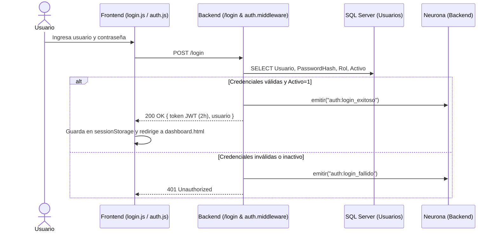
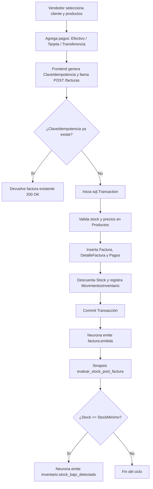
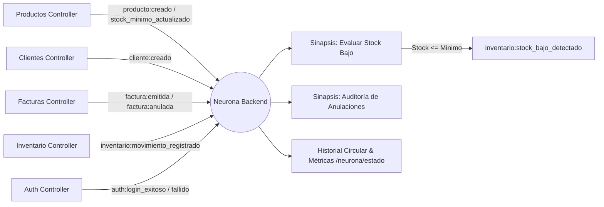

# Flujo de Trabajo — SOUVANIC

## 1. Flujo de Autenticación y Sesión


---

## 2. Flujo de Facturación, Pagos e Inventario (con Neurona)


---

## 3. Flujo de Anulación de Factura
1. El **Administrador** solicita `POST /facturas/:id/anular` con un motivo obligatorio.
2. El controlador abre una transacción SQL y verifica que la factura exista y no esté ya `Anulada`.
3. Por cada ítem de `DetalleFactura`:
   - Restaura `Productos.Stock = Stock + Cantidad`.
   - Inserta un registro `Entrada` en `MovimientosInventario` vinculado a `IdFactura`.
4. Marca los pagos asociados (`Registrado`/`Verificado`) para revisión y actualiza `Facturas.Estado = 'Anulada'`.
5. Al confirmar (`commit`), **Neurona** emite `factura:anulada` y dispara la sinapsis `auditoria_anulacion_factura`.

---

## 4. Arquitectura de Sinapsis (Núcleo Neurona)



---

## 5. Flujo de Desarrollo Local
1. **Base de datos**: Asegurar que SQL Server esté ejecutándose y `Backend/.env` contenga `DB_DATABASE` y `JWT_SECRET`.
2. **Backend**:
   ```powershell
   cd Backend
   npm start
   ```
   El servidor inicia en `http://localhost:3000`, registra las sinapsis de Neurona y ejecuta `asegurarEsquemaIntegral()`.
3. **Frontend**: Servir la carpeta raíz con Live Server / servidor estático en `http://localhost:8080` y abrir `http://localhost:8080/frontend/pages/index.html` (configurado en `.vscode/launch.json`).

